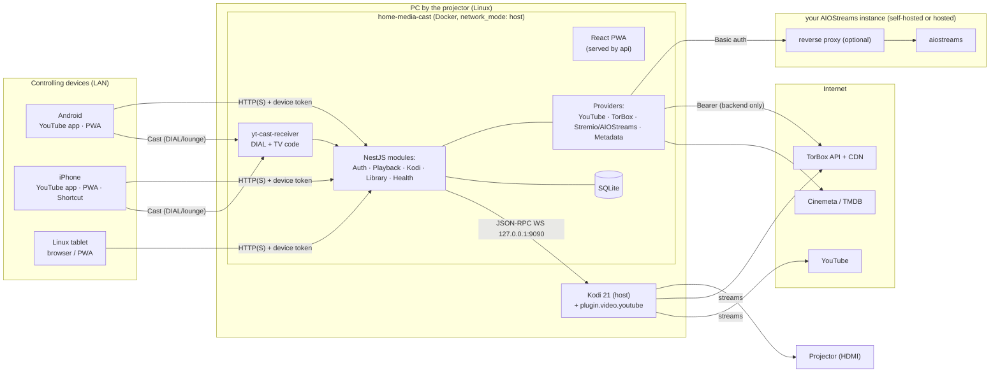
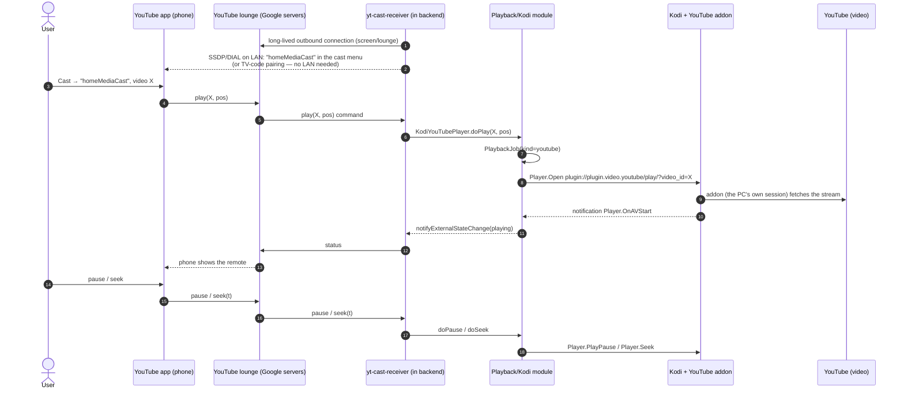
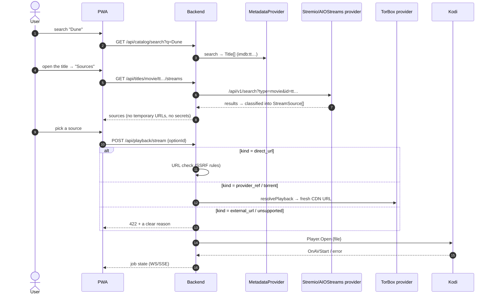
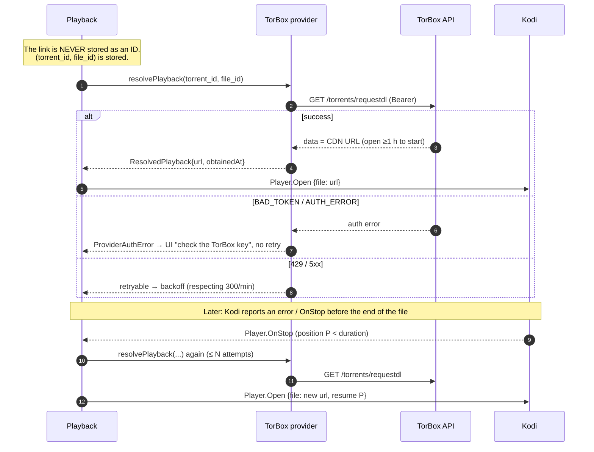
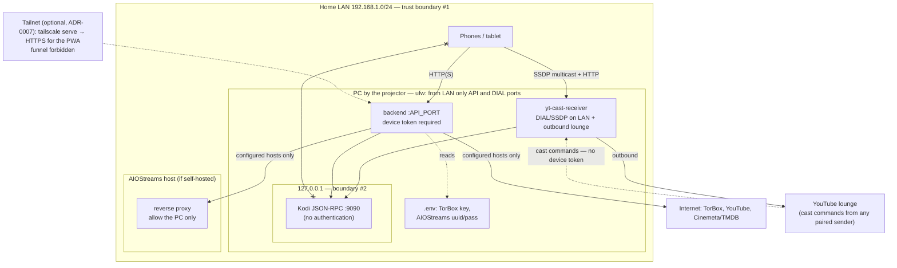

# Architecture diagrams

Based on ADR-0001 (backend on the PC by the projector) and ADR-0003 (our own cast receiver).

## 1. Overall architecture



## 2. YouTube from a phone (scenario A — the Cast button)



⚠️ Cast commands go **through YouTube's servers**, not directly from the phone over the LAN:
DIAL is only used for discovery and launch, and "Link with TV code" works with no shared
network at all (`yt-cast-receiver` README). Device tokens therefore **do not apply** to this
path — see the accepted exception in ADR-0007.

Scenario B (Share / pasted link) differs only at the start:
`PWA/Shortcut → POST /api/playback/youtube {url}` → parse `videoId` → the same `Player.Open` step.

## 3. A movie from the catalog → Kodi

⚠️ Partly planned. Today sources come from AIOStreams and play through the loopback relay
([security.md](security.md)); the separate TorBox provider branch is not built yet.



## 4. Refreshing a temporary TorBox link

⚠️ Planned design; the TorBox client and this retry are not built yet.



## 5. Network and security boundaries



The port table with exact values is in [networking.md](networking.md).

## 6. Browser playback and handoff

```mermaid
sequenceDiagram
  participant P as Phone / laptop (web)
  participant A as API
  participant R as Relay (loopback)
  participant F as ffmpeg
  participant K as Kodi

  P->>A: POST /api/browser-play {optionId, caps}
  A->>R: register link, preflight
  A->>F: spawn (relay URL only), copy or transcode to HLS in tmpfs
  A-->>P: session {id, run, adjacent, autoNext}
  P->>A: GET /api/media/:id/:run/index.m3u8 (the id is the capability)
  F->>R: read the file
  P->>A: segments; the player's progress every 5 s
  Note over P,A: first "playing" event = confirmStarted
  A->>K: tracker.end(), then Player.Stop (only if Kodi was playing)
  P->>A: ended → POST /next {caps}
  A->>A: findAdjacent (same release) → new session, old one ends
```

### Guests

```mermaid
sequenceDiagram
  participant G as New device (guest)
  participant A as API
  participant S as Active session
  participant K as Kodi

  G->>A: POST /api/guest {deviceName} (no token)
  A-->>G: limited token (guest)
  G->>A: browse, POST /api/browser-play (the TV keeps playing)
  A->>S: dead sessions of other devices end; live ones keep playing
  Note over A,K: a guest's confirm stops nothing; the TV starting leaves it running
  G->>A: control the TV → 403 guest_forbidden (the web asks to pair instead)
  G->>A: POST /api/pairing/complete (guest bearer + code from the TV)
  A-->>G: same device id, new paired token; the session keeps playing
```
