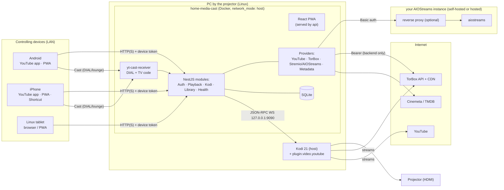
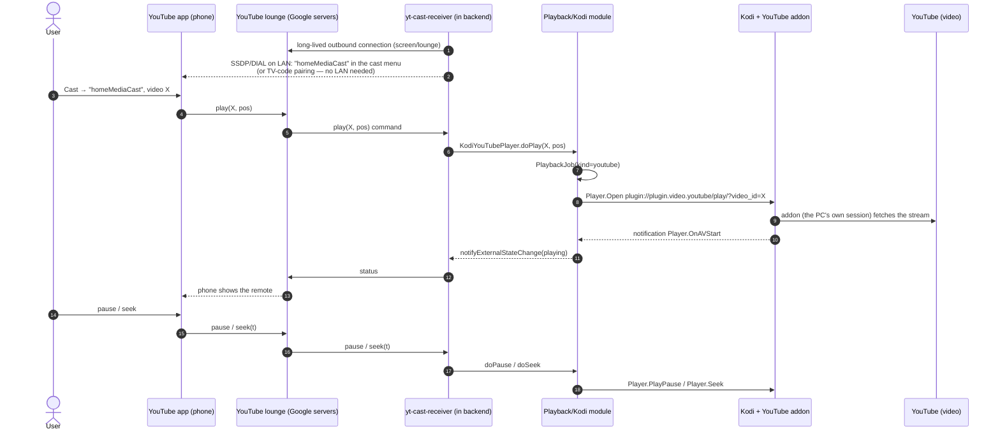
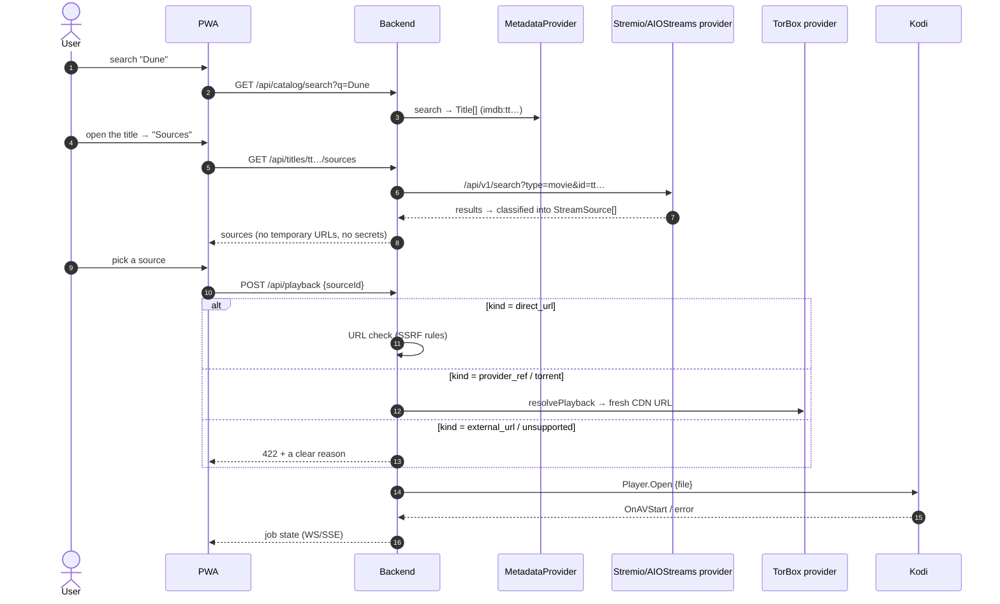
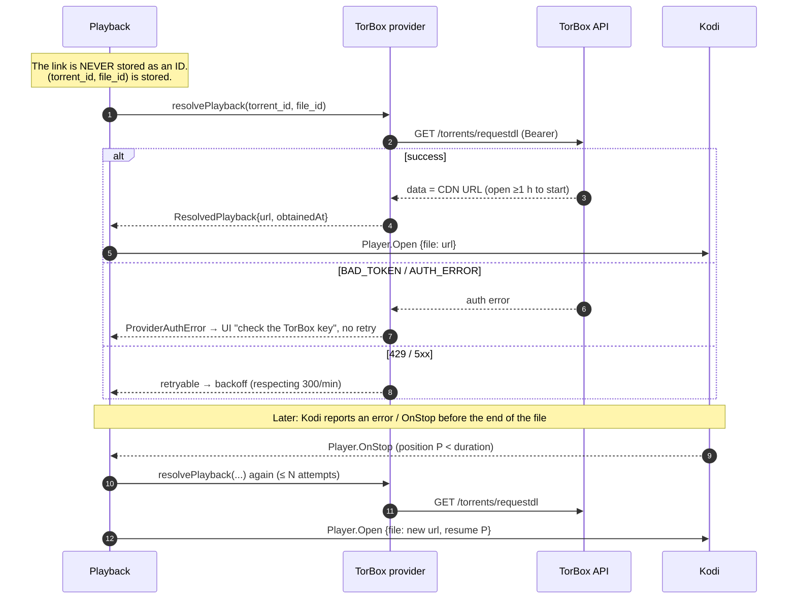
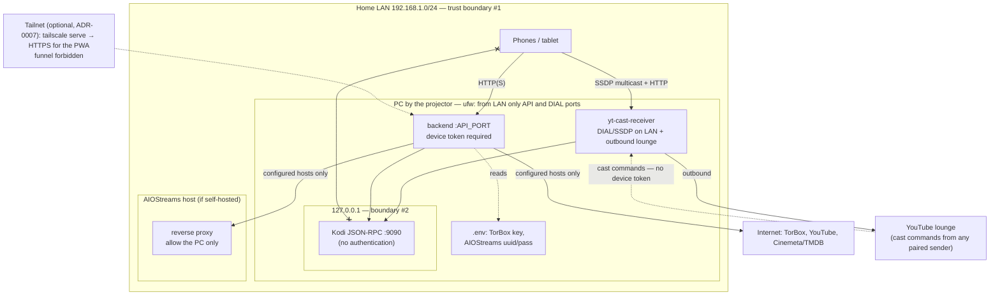

# Architecture diagrams

Based on ADR-0001 (backend on the PC by the projector) and ADR-0003 (our own cast receiver).

## 1. Overall architecture

## 2. YouTube from a phone (scenario A — the Cast button)

⚠️ Cast commands go **through YouTube's servers**, not directly from the phone over the LAN:
DIAL is only used for discovery and launch, and "Link with TV code" works with no shared
network at all (`yt-cast-receiver` README). Device tokens therefore **do not apply** to this
path — see the accepted exception in ADR-0007.

Scenario B (Share / pasted link) differs only at the start:
`PWA/Shortcut → POST /api/playback/youtube {url}` → parse `videoId` → the same `Player.Open` step.

## 3. A movie from the catalog → Kodi

## 4. Refreshing a temporary TorBox link

## 5. Network and security boundaries

The port table with exact values goes into `docs/networking.md` once ports are chosen in
Stage 1 (`API_PORT` and the `yt-cast-receiver` DIAL port — ⚠️ find its default and make it
configurable).
